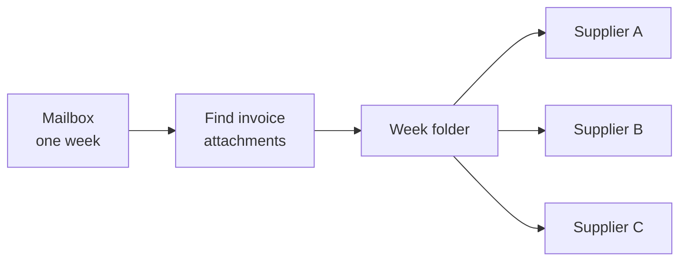

# Invoice pipeline automation

**A week of supplier invoices pulled from the mailbox and filed by week and supplier, automatically.**

- Sweeps a full week of mailbox traffic
- Handles PDFs and photographed invoices
- Feeds the weekly cost-of-sales report

> Source is private (business system). **[Full write-up →](https://sajjad.omni-genai.com/projects/invoice-pipeline)**

`Python` · `Microsoft Graph` · `Device-code OAuth`

<b>How it works</b>

<b>Third attempt lucky: what went wrong first</b>

- **Attempt 1, the local mail store:** it never downloaded server attachments. Around 1,200 of 5,000 messages had nothing attached, and forcing downloads made it worse.
- **Attempt 2, a low-code tool:** it could read the mailbox but the licence had no file storage, so there was nowhere to write.
- **Attempt 3, what works:** rebuilt server-side on the Microsoft Graph API with device-code sign-in and a cached token, using Python's standard library alone.

---

Built by **[Sajjad Mahessar](https://sajjad.omni-genai.com)** · [LinkedIn](https://www.linkedin.com/in/sajjadmahessar/)
